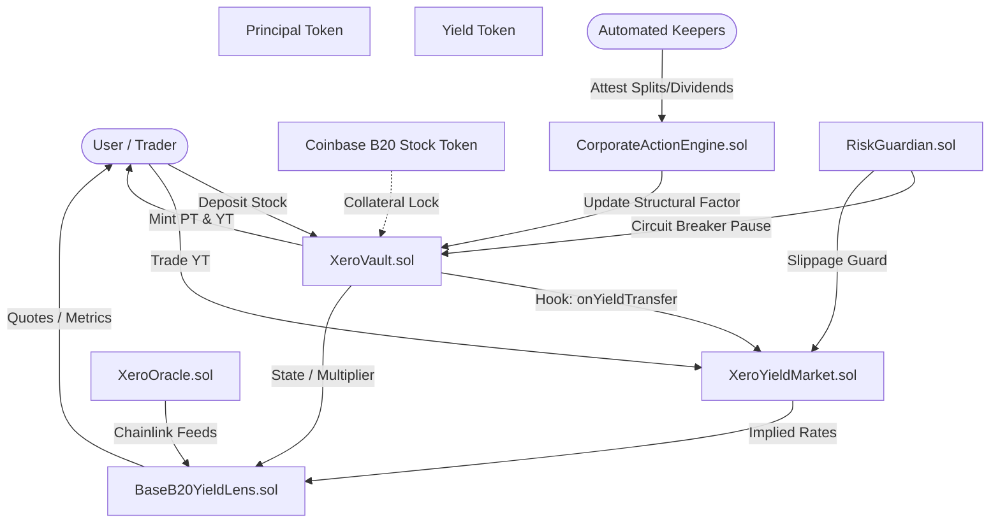

# Architecture Overview

Xero Protocol is architected as a modular, non-custodial smart contract system on Base, cleanly decoupling asset stripping, automated market making, corporate action verification, and analytical pricing.

---

## 🏛️ System Component Diagram

---

## 🧩 Architectural Layers

### 1. Vault & Tokenization Layer
* **[`XeroVault.sol`](smart-contract-reference.md#xerovaultsol):** The core custody and stripping engine. Holds raw B20 stock collateral, mints/burns PT and YT, tracks the internal sanitized `dividendIndex`, and distributes accrued dividend cash flows.
* **[`XeroFactory.sol`](smart-contract-reference.md#xerofactorysol):** Deploys new vaults for validated tokenized stock assets and maturities.
* **[`XeroComponentToken.sol`](smart-contract-reference.md#xerocomponenttokensol):** Standard ERC-20 implementation for PT and YT tokens, featuring a gas-optimized transfer hook for continuous yield checkpointing.

### 2. Yield-Space AMM Layer
* **[`XeroYieldMarket.sol`](smart-contract-reference.md#xeroyieldmarket-amm):** Maturity-aware liquidity pool trading YT against the underlying stock quote asset. Implements logarithmic rate pricing ($P_{YT} = r \times \tau$) to prevent time-decay divergence loss.
* **[`YieldMarketFactory.sol`](smart-contract-reference.md#yieldmarketfactorysol):** Deploys and registers liquidity pools.
* **[`XeroMathLib.sol`](smart-contract-reference.md#xeromathlibsol):** Fixed-point logarithmic and bisection math engine.

### 3. Corporate Action & Risk Layer
* **[`CorporateActionEngine.sol`](smart-contract-reference.md#corporateactionenginesol):** Authenticated, append-only log of attested corporate actions (splits, reverse splits, cash dividends). Enforces multi-reporter quorum before actions become effective.
* **[`RiskGuardian.sol`](smart-contract-reference.md#riskguardiansol):** Emergency circuit breaker and parameter validation guard.

### 4. Lens & Oracle Layer
* **[`BaseB20YieldLens.sol`](yield-lens-api.md):** Analytical aggregation contract providing instantaneous UI quotes for fixed APYs, upfront cash yields, and leverage multiples.
* **[`XeroOracle.sol`](smart-contract-reference.md#xerooraclesol):** Consumes Chainlink Total Return feeds and validates the Base L2 Sequencer Uptime Feed.
