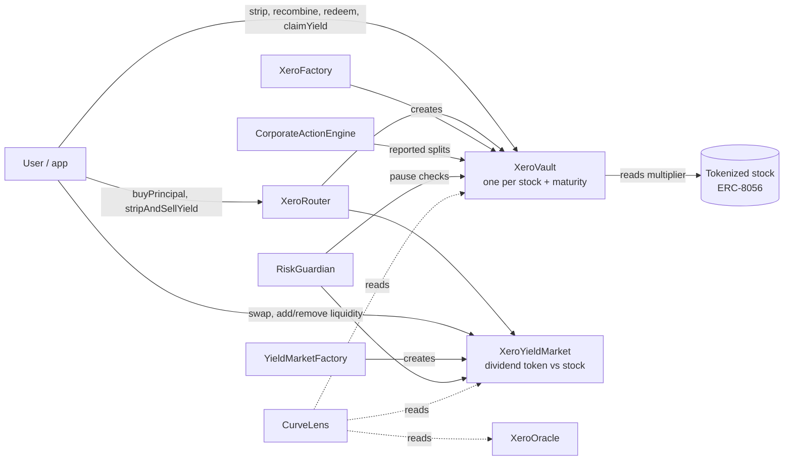

Xero is a small set of Solidity contracts on Base. Each one has a single job.



| Contract | Role |
| --- | --- |
| **XeroVault** | Holds tokenized shares for one stock and maturity. Mints and burns share tokens (PT) and dividend tokens (YT), credits dividends to YT, settles maturity. |
| **XeroComponentToken** | The ERC-20 used for every PT and YT. YT transfers settle accrued dividends for both sides first. |
| **XeroFactory** | Creates and registers vaults; holds fee settings and the treasury. |
| **XeroYieldMarket** | A pool trading one vault's YT against its tokenized stock. Prices by an implied dividend rate that decays to maturity. Its ERC-20 is the LP share. |
| **YieldMarketFactory** | Creates the one canonical market per vault and selects the pricing engine. |
| **XeroRouter** | Stateless one-transaction flows: buy at a discount, take dividends upfront, split, exit. Holds nothing between calls. |
| **CorporateActionEngine** | Append-only log of corporate actions per stock, effective once a quorum of reporters agrees. |
| **RiskGuardian** | Circuit breakers that can stop new deposits and trades, never exits. |
| **XeroOracle** | USD prices with staleness checks. Display only: no settlement depends on it. |
| **CurveLens** | Read-only view returning every maturity for a stock, with prices and implied yields. |

## The core accounting

A tokenized stock's multiplier `M` grows when dividends are reinvested and jumps on splits. The vault divides out the reported structural factor `S` to get a **dividend index** `I = M / S`, which only grows with dividends.

```text
strip(raw) at index I0      →  units = raw × (1 − fee) × I0   PT and YT
PT at maturity               →  units ÷ I_maturity              tokenized stock
YT while I grows I_a → I_b   →  units × (1/I_a − 1/I_b)         tokenized stock, claimable
```

PT claims plus YT accruals always sum to the deposited tokens, so every vault is fully collateralised by construction. If the multiplier moves in a way the vault can't explain (an unreported split, or a jump above `maxGrowthPerSync` without a reported cash dividend), the vault **freezes** new deposits and dividend crediting until it's explained. Recombination always works.

## Repository layout

| Path | Contents |
| --- | --- |
| `contracts/` | Foundry project: `src/`, tests (unit, fuzz, invariant, parity) and deploy scripts |
| `app/` | React + Vite web app (wagmi, RainbowKit, TanStack Query) |
| `services/keeper/` | Corporate-action reporter |
| `stylus/xero-math/` | Rust pricing engine for Arbitrum Stylus, tested against the Solidity version |
| `docs/` | This documentation (Mintlify) |
